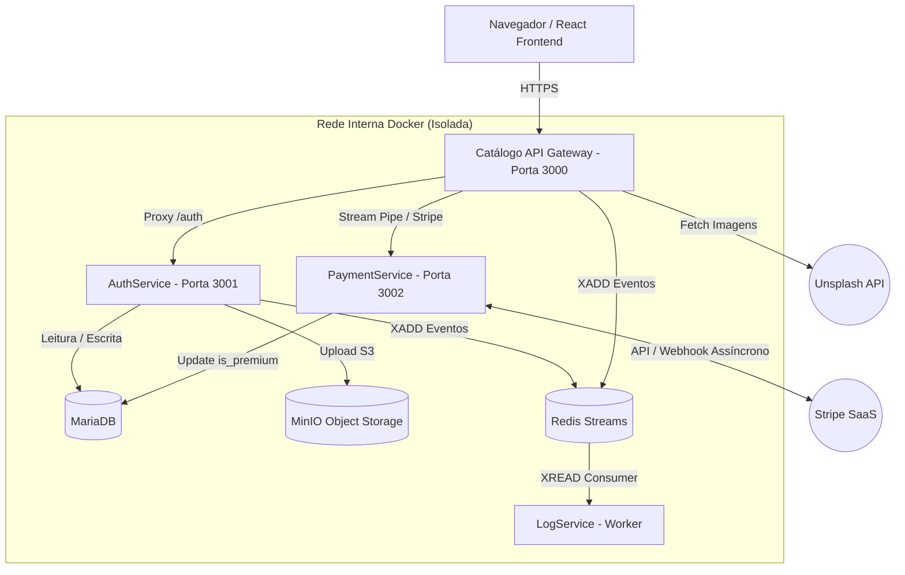
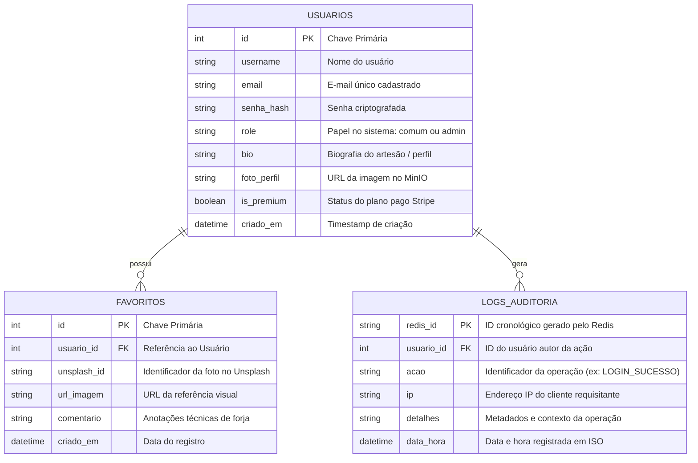

# Documentação do Sistema - Cutelaria Marquesin

## 1. Especificação (Visão do Usuário)

O sistema **"Forja & Fogo / Cutelaria Marquesin"** é uma plataforma distribuída em nuvem que adota o modelo **SaaS Freemium** voltada para amantes, colecionadores e artesãos da cutelaria tradicional. A plataforma provê curadoria de peças, gestão social de perfis, controle de acesso e auditoria em tempo real. A experiência do sistema é segmentada sob a perspectiva dos seguintes papéis:

* **Visitante (Não Autenticado):**
  * **Login e Cadastro:** Acessa as telas públicas de apresentação, podendo criar uma nova conta com e-mail, nome de usuário e senha segura (criptografada em hash) ou realizar login para obter um token JWT assinado. Caso esqueça a senha, pode acionar o fluxo de recuperação com link temporário enviado por e-mail.
  * **Restrições:** Não possui acesso às áreas protegidas (perfil, upload de avatar, mural de favoritos e painel administrativo).

* **Usuário Comum (Plano Grátis):**
  * **Catálogo:** Navega livremente pela galeria de facas e lâminas de referência integradas em alta resolução via API do Unsplash.
  * **Favoritos:** Pode salvar referências de lâminas em seu mural pessoal adicionando notas/comentários de forja, com **limite estrito de até 3 favoritos**.
  * **Avatar e Perfil:** Possui página exclusiva de perfil onde pode editar sua biografia pessoal e realizar upload de foto de avatar (processada em memória e persistida no Object Storage MinIO).
  * **Plano Pago:** Visualiza em seu perfil o botão para solicitar upgrade para o plano Premium via checkout seguro.

* **Usuário Premium (Plano Pago):**
  * **Benefícios e Distinção:** Identificado na plataforma com o badge exclusivo **"👑 Mestre Premium"** exibido em seu perfil.
  * **Favoritos Ilimitados:** Tem a limitação de 3 itens removida, podendo favoritar quantas referências de lâminas desejar no catálogo.
  * **Plano Pago:** Assinatura gerenciada via Stripe, com ativação automática instantânea após a confirmação do pagamento via Webhook.

* **Administrador (Admin):**
  * **Gestão da Forja:** Possui todos os privilégios dos usuários comuns e premium, além de acesso exclusivo ao painel administrativo (`/admin`).
  * **Gestão de Acessos (RBAC):** Pode listar todos os usuários da base de dados e promover usuários comuns ao papel de administrador.
  * **Auditoria de Segurança:** Acessa a central de logs em tempo real, visualizando tentativas de acesso negado (403), autenticações, ações de negócio e endereços IP de origem registrados na trilha de auditoria.

---

## 2. Arquitetura (Diagrama de Microsserviços)

A solução é arquitetada em microsserviços desacoplados seguindo o Princípio da Responsabilidade Única (SRP), operando em rede isolada e orquestrada via Docker Compose.

---

## 3. Regras de Negócio (Formato Estrito: Se X, então Y)

Para garantir determinismo de comportamento e alinhamento às especificações formais de engenharia de software, todas as regras de negócio do sistema são descritas estritamente na forma condicional **"Se X, então Y"**:

### 3.1. Autenticação, Identidade e Sessão
1. **Se** usuário não autenticado requisitar recurso privado (`/perfil`, `/referencias`), **então** o sistema rejeita a requisição com status `HTTP 401 (Unauthorized)`.
2. **Se** usuário fornecer credenciais válidas na rota de login, **então** o AuthService emite um token JWT assinado contendo as claims de identificação (`id`, `username`, `role`).
3. **Se** token JWT recebido no cabeçalho estiver expirado ou com assinatura inválida, **então** o sistema bloqueia o acesso exigindo nova autenticação.
4. **Se** usuário solicitar recuperação de senha com e-mail cadastrado, **então** o sistema gera token temporário UUID com validade de 30 minutos e envia link seguro via SMTP.

### 3.2. Catálogo e Favoritos (Freemium)
5. **Se** usuário comum (não premium) com 3 favoritos tentar favoritar uma nova lâmina, **então** o sistema bloqueia a criação e exibe aviso exigindo upgrade para o plano Premium.
6. **Se** usuário for premium (`is_premium = true`), **então** o limite de favoritos é removido permitindo salvar referências ilimitadas no catálogo.
7. **Se** usuário autenticado salvar uma referência válida, **então** o sistema grava o registro na tabela de favoritos e dispara evento assíncrono para a trilha de auditoria.

### 3.3. Avatar e Perfil (Object Storage)
8. **Se** upload de avatar for realizado com extensão diferente de imagem ou tamanho superior a 5MB, **então** o backend rejeita a requisição com erro de validação.
9. **Se** imagem de avatar for válida, **então** o AuthService envia o arquivo binário para o bucket público do MinIO e atualiza a coluna `foto_perfil` no MariaDB com a URL pública gerada.
10. **Se** usuário alterar sua biografia, **então** o sistema atualiza as informações cadastrais diretamente no banco de dados MariaDB.

### 3.4. Pagamento e Assinatura (Stripe SaaS)
11. **Se** usuário autenticado clicar em fazer upgrade, **então** o PaymentService gera uma sessão de Checkout Stripe com o `client_reference_id` associado ao ID do usuário e retorna a URL de pagamento.
12. **Se** o webhook do Stripe receber o evento `checkout.session.completed` com assinatura criptográfica válida, **então** o PaymentService atualiza o campo `is_premium` para `true` na tabela de usuários do MariaDB.
13. **Se** a assinatura criptográfica do webhook Stripe for inválida, **então** o PaymentService rejeita a requisição com status `HTTP 400 (Bad Request)`.

### 3.5. Controle de Acesso e Auditoria (RBAC & Observabilidade)
14. **Se** usuário sem o papel de administrador tentar acessar rotas `/admin` ou consultar `/logs`, **então** o middleware bloqueia a requisição retornando `HTTP 403 (Forbidden)`.
15. **Se** ocorrer bloqueio por violação de privilégio (403), **então** o sistema gera automaticamente um log no Redis com a ação `TENTATIVA_ACESSO_ADMIN_NEGADO` capturando o endereço IP de origem.
16. **Se** qualquer ação relevante ocorrer no sistema (login, logout, criação de favoritos), **então** o serviço produtor publica uma mensagem via comando `XADD` no Redis Streams.
17. **Se** mensagens forem enfileiradas no Redis Streams, **então** o LogService consome os registros via `XREAD` e disponibiliza a consulta cronológica para visualização do Administrador.

---

## 4. Modelo de Dados (Diagrama ER)

O modelo relacional (MariaDB) gerencia as entidades de usuários e favoritos, enquanto o Redis persiste a trilha de eventos de auditoria. O diagrama entidade-relacionamento abaixo ilustra as entidades principais e seus relacionamentos diretos:

